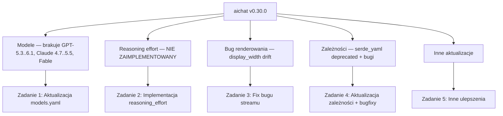
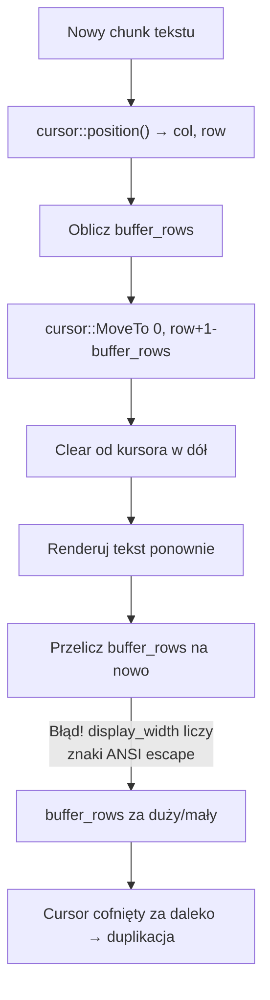
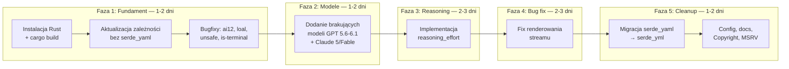

# Plan Rozwoju aichat — Aktualizacja po roku nierozwijania

> [!NOTE]
> Stan na: 2026-10-01 • Wersja bazowa: `0.30.0`
> Cel: zaktualizować narzędzie CLI `aichat` do bieżących realiów (modele, reasoning, bugi, zależności)

---

## Podsumowanie Stanu Projektu



---

## Zadanie 1: Aktualizacja listy modeli

### Stan obecny
Plik [`models.yaml`](file:///home/ubuntu/aichat/models.yaml) zawiera ok. 307 definicji modeli, ale zatrzymał się na **GPT-5.2** i **Claude Sonnet 4.6**. Od tego momentu wyszło bardzo wiele nowych modeli.

Dane poniżej pochodzą z **zapytania do API OpenRouter** (`GET /api/v1/models`) wykonanego 2026-10-01.

### Brakujące modele OpenAI (priorytetowe wg użytkownika)

| Model | Context | Max Output | Input \$/M | Output \$/M | Vision | Priorytet |
|-------|---------|------------|-----------|------------|--------|-----------|
| **`gpt-5.6-luna`** | 1,050K | 128K | \$0.20 | \$1.20 | ✅ | 🔴 |
| **`gpt-5.6-sol`** | 1,050K | 128K | \$2.00 | \$10.00 | ✅ | 🔴 |
| `gpt-5.6-terra` | 1,050K | 128K | \$2.00 | \$12.00 | ✅ | 🟡 |
| **`gpt-6-luna`** | 1,050K | 128K | \$0.10 | \$0.50 | ✅ | 🔴 |
| **`gpt-6-sol`** | 1,050K | 128K | \$2.00 | \$10.00 | ✅ | 🔴 |
| **`gpt-6-astra`** | 1,050K | 128K | \$10.00 | \$50.00 | ✅ | 🔴 |
| **`gpt-6.1-sol`** | 1,050K | 128K | \$2.00 | \$10.00 | ✅ | 🔴 |
| `gpt-5.3-codex` | 400K | 128K | \$1.75 | \$14.00 | ? | 🟡 |
| `gpt-5.4` | 1,050K | 128K | \$2.50 | \$15.00 | ✅ | 🟡 |
| `gpt-5.4-mini` | 400K | 128K | \$0.75 | \$4.50 | ✅ | 🟡 |
| `gpt-5.4-nano` | 400K | 128K | \$0.20 | \$1.25 | ✅ | 🟡 |
| `gpt-5.4-pro` | 1,050K | 128K | \$30.00 | \$180.00 | ✅ | ⚪ |
| `gpt-5.5` | 1,050K | 128K | \$5.00 | \$30.00 | ✅ | 🟡 |
| `gpt-5.5-pro` | 1,050K | 128K | \$30.00 | \$180.00 | ✅ | ⚪ |
| `gpt-5-pro` | 400K | 128K | \$15.00 | \$120.00 | ✅ | ⚪ |
| `gpt-5.1-codex` | 400K | 128K | \$1.25 | \$10.00 | ? | ⚪ |
| `gpt-5.1-codex-max` | 400K | 128K | \$1.25 | \$10.00 | ? | ⚪ |
| `gpt-5.1-codex-mini` | 400K | 128K | \$0.25 | \$2.00 | ? | ⚪ |
| `gpt-5-image` / `gpt-5-image-mini` | 400K | 128K | — | — | ✅ | ⚪ |
| `gpt-5.4-image-2` | 272K | 128K | — | — | ✅ | ⚪ |
| `gpt-5.6-luna-pro` / `gpt-6-*-pro` | 1,050K | 128K | varied | varied | ✅ | ⚪ |

### Brakujące modele Anthropic (priorytetowe)

| Model | Context | Max Output | Input \$/M | Output \$/M | Vision | Priorytet |
|-------|---------|------------|-----------|------------|--------|-----------|
| **`claude-fable-5`** | 1,000K | 128K | \$10.00 | \$50.00 | ✅ | 🔴 |
| **`claude-fable-5.1`** | 1,000K | 128K | \$10.00 | \$50.00 | ✅ | 🔴 |
| **`claude-sonnet-5`** | 1,000K | 128K | \$2.00 | \$10.00 | ✅ | 🔴 |
| **`claude-sonnet-5.5`** | 1,000K | 128K | \$2.00 | \$10.00 | ✅ | 🔴 |
| **`claude-opus-5`** | 1,000K | 128K | \$5.00 | \$25.00 | ✅ | 🔴 |
| **`claude-opus-5.5`** | 1,000K | 128K | \$4.00 | \$20.00 | ✅ | 🔴 |
| `claude-opus-4.7` | 1,000K | 128K | \$5.00 | \$25.00 | ✅ | 🟡 |
| `claude-opus-4.8` | 1,000K | 128K | \$5.00 | \$25.00 | ✅ | 🟡 |
| `claude-opus-4.1` | 200K | 32K | \$15.00 | \$75.00 | ✅ | ⚪ |
| `claude-haiku-4.5` | 200K | 64K | \$1.00 | \$5.00 | ✅ | 🟡 |

### Co jest obecne w models.yaml (dla porównania)

Aktualnie `models.yaml` zawiera z OpenAI: `gpt-5.2`, `gpt-5`, `gpt-5-mini`, `gpt-5-nano`, `gpt-4.1` i starsze.
Z Anthropic: `claude-opus-4-6`, `claude-sonnet-4-6` (i warianty `:thinking`), `claude-opus-4-5`, `claude-sonnet-4-5`, `claude-haiku-4-5`.

> [!IMPORTANT]
> Brakuje **~30 modeli OpenAI** i **~10 modeli Anthropic** od wersji, na której zatrzymał się development.

### Kroki do wykonania

1. **Dodać priorytetowe modele** (🔴) do:
   - Sekcji `openai` w `models.yaml` (bezpośredni dostawca)
   - Sekcji `openrouter` (przez OpenRouter)
   - Warianty pro i batch mogą być dodane później

2. **Format wpisu** — każdy model potrzebuje:
   ```yaml
   - name: gpt-6-sol
     max_input_tokens: 1050000
     max_output_tokens: 128000
     input_price: 2
     output_price: 10
     supports_vision: true
     supports_function_calling: true
   ```

3. **Dodać warianty `:thinking`** dla modeli Claude (Fable, Sonnet 5, Opus 5) z:
   ```yaml
   - name: claude-sonnet-5:thinking
     real_name: claude-sonnet-5
     max_output_tokens: 128000
     require_max_tokens: true
     patch:
       body:
         temperature: null
         top_p: null
         thinking:
           type: enabled
           budget_tokens: 16000
   ```

4. **Dodać odpowiedniki na OpenRouter**:
   ```yaml
   - name: openai/gpt-6-sol
     max_input_tokens: 1050000
     max_output_tokens: 128000
     input_price: 2
     output_price: 10
     supports_vision: true
     supports_function_calling: true
   ```

5. **Zweryfikować modele średniego priorytetu (🟡)** i dodać w kolejnym kroku

### Potencjalne pułapki
- ⚠️ Nazwy modeli na OpenRouter (z prefixem `openai/`, `anthropic/`) różnią się od nazw bezpośrednich API
- ⚠️ `models.yaml` jest embedowany w binarce (`include_str!("../../models.yaml")`) — trzeba go zaktualizować i zrekompilować
- ⚠️ Modele mogą mieć różne API capabilities, których nie widać z listy OpenRouter (np. function calling, structured output)
- ⚠️ Warianty `-pro` i `:batch` mają ten sam model ale inne ceny/limity — rozważyć czy dodawać osobno
- ⚠️ Nowa klasa modeli **Fable** od Anthropic — sprawdzić czy wymaga zmian w kliencie claude.rs

### Weryfikacja
```bash
# Test najnowszych modeli przez OpenRouter
aichat -m openrouter:openai/gpt-6-sol "Hello, world!"
aichat -m openrouter:anthropic/claude-sonnet-5.5 "Hello, world!"
aichat -m openrouter:anthropic/claude-fable-5.1 "Hello, world!"
```

---

## Zadanie 2: Implementacja reasoning_effort

### Stan obecny — KRYTYCZNY BRAK

> [!CAUTION]
> `reasoning_effort` **nie jest w ogóle zaimplementowany** w kodzie Rust.
> Nie ma ani pola w strukturze `ModelData`, ani parametru w konfiguracji, ani logiki wysyłania go w request body.

Jedynym sposobem na ustawienie go dziś jest ręczne dodanie w `patch.body` w `models.yaml`:
```yaml
patch:
  body:
    reasoning_effort: medium
```
Ale **żaden model tego nie robi** domyślnie.

### Jak reasoning działa u poszczególnych dostawców

| Dostawca | Parametr API | Wartości | Modele |
|----------|-------------|----------|--------|
| **OpenAI** | `reasoning_effort` w body | `low`, `medium`, `high` | o1, o3, o4-mini (starsze), potencjalnie GPT-5.6+/6 |
| **Anthropic** | `thinking.budget_tokens` w body | Integer (np. 8000, 16000) | Claude `:thinking` warianty |
| **Google Gemini** | `thinkingConfig.thinkingBudget` | Integer | Gemini 2.5 Pro/Flash |
| **DeepSeek** | Brak parametru effort | N/A | deepseek-reasoner (zawsze reasoning) |
| **Cohere** | `thinking.enabled` + `thinking.budget_tokens` | Boolean + Integer | command-a-reasoning |

### Plan implementacji

#### Krok 2.1 — Dodanie pola `reasoning_effort` do konfiguracji
W [`src/client/model.rs`](file:///home/ubuntu/aichat/src/client/model.rs) — dodać nowe pole w `ModelData`:
```rust
// W strukturze ModelData (linia 296)
#[serde(skip_serializing_if = "Option::is_none")]
pub reasoning_effort: Option<String>, // "low", "medium", "high" lub null
```

#### Krok 2.2 — Dodanie `reasoning_effort` do `ChatCompletionsData`
W pliku gdzie zdefiniowana jest `ChatCompletionsData`:
```rust
pub struct ChatCompletionsData {
    pub messages: Vec<Message>,
    pub temperature: Option<f64>,
    pub top_p: Option<f64>,
    pub functions: Option<Vec<FunctionDeclaration>>,
    pub stream: bool,
    pub reasoning_effort: Option<String>, // NOWE
}
```

#### Krok 2.3 — Wstrzyknięcie do body dla OpenAI/compatible
W [`src/client/openai.rs`](file:///home/ubuntu/aichat/src/client/openai.rs) (linia ~310-343):
```rust
// Po ustawieniu stream, przed return body
if let Some(ref effort) = data.reasoning_effort {
    body["reasoning_effort"] = effort.clone().into();
}
```

#### Krok 2.4 — Mapowanie na różne formaty API
- **Claude**: Mapować `"medium"` → `budget_tokens: 16000` (w `src/client/claude.rs`)
- **Gemini**: Mapować na `thinkingConfig.thinkingBudget` (w `src/client/gemini.rs` / `vertexai.rs`)
- **Bedrock**: Odpowiedni format AWS

#### Krok 2.5 — Domyślna wartość "medium"
W `models.yaml` dodać `reasoning_effort: medium` (lub odpowiednik) do **wszystkich modeli z obsługą reasoning**:
- OpenAI reasoning models
- Claude: warianty `:thinking`
- Gemini: 2.5 Pro/Flash
- Inne: według możliwości

#### Krok 2.6 — Opcja CLI/konfiguracyjna
Dodać flagę `--reasoning-effort` lub pole konfiguracyjne, by użytkownik mógł nadpisać default.

### Potencjalne pułapki
- ⚠️ **Różne dostawcy mają różne formaty** — trzeba mapować `"low"/"medium"/"high"` na integer `budget_tokens` dla Claude/Gemini
- ⚠️ **Nie wszystkie modele obsługują reasoning** — trzeba dodać `supports_reasoning: bool` do `ModelData` albo wnioskować z nazwy/wariantu
- ⚠️ **Niektóre modele nie akceptują temperature** razem z reasoning — ustawienie obu da błąd API
- ⚠️ **Mechanizm `patch`** — dodane pole musi koegzystować z istniejącym systemem `patch.body`
- ⚠️ **Backward compatibility** — nowe pole musi mieć `#[serde(default)]` by starsze pliki YAML się dalej parsowały

### Weryfikacja
```bash
# Sprawdzić, że domyślnie jest medium
aichat -m openrouter:openai/o3 "Solve: x^2 + 2x - 3 = 0"
# Powinno wysłać reasoning_effort: "medium" w request body

# Sprawdzić nadpisanie
aichat -m openrouter:openai/o3 --reasoning-effort high "Prove Goldbach's conjecture for n < 100"
```

---

## Zadanie 3: Naprawa bugu renderowania (duplikacja linii)

### Opis problemu
Po kilku turach rozmowy w trybie REPL, wyświetlanie na konsoli "rozjeżdża się":
- Widać 1 linijkę, potem ekran odświeża się i widać od nowa 2 linijki, potem 3 linijki etc.
- Efekt "narastającego tekstu" — cursor jest cofany zbyt daleko i tekst nadpisuje się od początku

### Analiza przyczyny

Winowajcą jest [`src/render/stream.rs`](file:///home/ubuntu/aichat/src/render/stream.rs) — funkcja `markdown_stream_inner` (linie 67-162):



**Główna przyczyna**: Funkcja `need_rows()` (linia 214-217) używa `display_width()` z crate `textwrap`, które **liczy wizualną szerokość tekstu**. Problem:

1. **ANSI escape codes** z syntax highlightera (kolorowanie kodu) — `display_width()` z textwrap 0.16 może niepoprawnie liczyć ich szerokość, traktując escape sequences jako widoczne znaki
2. **Unicode / CJK / emoji** — znaki o szerokości 2 kolumn mogą być liczone jako 1 lub odwrotnie
3. **Wrapping tekstu** — gdy markdown renderer dodaje zawijanie linii, `buffer_rows` nie odpowiada faktycznym wierszom terminala
4. **`columns` jest pobierany raz** (linia 76) — jeśli terminal jest zmieniony w rozmiarze, stara wartość powoduje błędne obliczenia
5. **Kitty terminal hack** (linia 103-106) — specyficzne obejście dla Kitty może powodować problemy w innych terminalach

### Plan naprawy

#### Krok 3.1 — Poprawić `need_rows()` aby ignorować ANSI escape codes
```rust
fn need_rows(text: &str, columns: u16) -> u16 {
    // Strip ANSI escape sequences before calculating width
    let stripped = strip_ansi_escapes(text);
    let buffer_width = display_width(&stripped).max(1) as u16;
    buffer_width.div_ceil(columns)
}
```
Lub użyć `unicode-width` bezpośrednio na stripped tekście.

#### Krok 3.2 — Odświeżać `columns` przy każdym chunkie
```rust
// Zamiast jednorazowego `let columns = terminal::size()?.0;` (linia 76),
// pobierać rozmiar terminala w każdej iteracji pętli
let columns = terminal::size()?.0;
```

#### Krok 3.3 — Poprawić `print_block` aby lepiej liczyć wiersze
Funkcja `print_block` (linia 192-203) liczy `num` jako liczbę `\n` w tekście, ale nie uwzględnia zawijania długich linii:
```rust
fn print_block(writer: &mut Stdout, text: &str, columns: u16) -> Result<u16> {
    let mut num = 0;
    for line in text.split('\n') {
        queue!(writer, style::Print(line), style::Print("\n"), cursor::MoveLeft(columns))?;
        // Trzeba dodać liczbę dodatkowych wierszy z zawijania:
        num += need_rows(line, columns);
    }
    Ok(num)
}
```

#### Krok 3.4 — Rozważyć alternatywne podejście
Zamiast skomplikowanej manipulacji kursorem, rozważyć użycie alternatywnego ekranu (`alternate screen`) lub prostszej strategii renderowania, np. tylko dopisywania tekstu bez cofania kursora.

### Potencjalne pułapki
- ⚠️ **Naprawa może złamać Kitty terminal** — hack z linii 103-106 został dodany celowo
- ⚠️ **ANSI strip musi być efektywny** — stripping w hot path może spowalniać rendering
- ⚠️ **Reedline conflicts** — terminal raw mode + cursor manipulation mogą kolidować z REPL
- ⚠️ **Trudno do debugowania** — bug pojawia się "po kilku turach", więc może być związany z kumulacją drobnych błędów `buffer_rows`

### Weryfikacja
```bash
# Test wieloturowy z dłuższymi odpowiedziami (kod, markdown)
# Uruchomić w różnych terminalach: gnome-terminal, kitty, alacritty, tmux
aichat
# W REPL: zadać 5+ pytań z odpowiedziami zawierającymi kod
```

---

## Zadanie 4: Aktualizacja zależności i bugfixy kodu

### Krytyczne aktualizacje

| Zależność | Obecna | Problem | Akcja |
|-----------|--------|---------|-------|
| **`serde_yaml`** | 0.9.17 | ❌ **Deprecated i unmaintained** (archived Mar 2024) | Migracja do `serde_yml` |
| **`is-terminal`** | 0.4.9 | ❌ **Redundant** — `std::io::IsTerminal` w Rust 1.70+ | Usunąć, użyć stdlib |
| **`textwrap`** | 0.16.0 | Stara wersja, `display_width` API | Aktualizacja do 0.16.2+ |
| **`crossterm`** | 0.28.1 | Stary, 0.29+ dostępny | Aktualizacja — może pomóc z bugiem renderowania |
| **`tokio`** | 1.34.0 | Stary (lock: 1.46.1) | Podnieść constraint |
| **`reqwest`** | 0.12.0 | Stary (lock: 0.12.22) | Podnieść constraint |
| **`serde`** | 1.0.152 | Bardzo stary | Aktualizacja do 1.0.217+ |

### Odkryte bugi w kodzie

> [!WARNING]
> Analiza kodu ujawniła dodatkowe bugi wymagające naprawy.

#### 4.1 Typo w nazwie providera — `ai12` zamiast `ai21`
W [`config.example.yaml`](file:///home/ubuntu/aichat/config.example.yaml) (~linia 178):
```yaml
- type: openai-compatible
  name: ai12                    # ← BUG: powinno być: ai21
  api_base: https://api.ai21.com/studio/v1
```
Powoduje że lookup klucza szuka `AI12_API_KEY` zamiast `AI21_API_KEY`.

#### 4.2 Typo w nazwie metody — `loal_models_override`
W [`src/config/mod.rs`](file:///home/ubuntu/aichat/src/config/mod.rs) (~linia 1891) i [`src/client/common.rs`](file:///home/ubuntu/aichat/src/client/common.rs) (linia 26):
```rust
Config::loal_models_override()  // ← typo: "loal" zamiast "load"
```

#### 4.3 Unsafe code w `serde_vectors.rs`
[`src/rag/serde_vectors.rs`](file:///home/ubuntu/aichat/src/rag/serde_vectors.rs) — `from_raw_parts` i `copy_nonoverlapping` dla konwersji `f32` ↔ `u8`. Podatne na problemy z alignment, ważne przy cross-compilation na **ARM** (Ampere A1!). Zastąpić `bytemuck`.

#### 4.4 Unsafe `from_utf8_unchecked` w `role.rs`
[`src/config/role.rs`](file:///home/ubuntu/aichat/src/config/role.rs) (linia 97) — `unsafe { std::str::from_utf8_unchecked }` na embedded assets. Zastąpić safe `std::str::from_utf8()`.

### Plan aktualizacji zależności

1. **Migracja `serde_yaml` → `serde_yml`** — dotyka ~18 plików:
   - `src/config/mod.rs`, `src/config/session.rs`, `src/config/agent.rs`, `src/config/role.rs`
   - `src/rag/mod.rs`, `src/client/common.rs`
   - API jest podobne, ale trzeba sprawdzić edge case'y

2. **Usunięcie `is-terminal`** — zamiana na `use std::io::IsTerminal;`

3. **Podnieść constraint'y w `Cargo.toml`** by odzwierciedlały faktyczne locked versions

4. **Naprawić typo `ai12` → `ai21`** i `loal` → `load`

### Potencjalne pułapki
- ⚠️ `serde_yaml` → `serde_yml` może mieć subtelne różnice w parsowaniu
- ⚠️ `crossterm` 0.28→0.29 może mieć breaking changes w cursor/terminal API
- ⚠️ **CI używa `RUSTFLAGS: --deny warnings`** — deprecation warning = broken build
- ⚠️ Aktualizacja wielu zależności na raz utrudnia debugowanie regresji

---

## Zadanie 5: Inne elementy do aktualizacji

### 5.1 Dodanie MSRV do Cargo.toml
Codebase używa `std::sync::LazyLock` (Rust 1.80+) — trzeba to udokumentować:
```toml
rust-version = "1.80"
```

### 5.2 Aktualizacja CI/CD
- Sprawdzić, czy workflow w [`.github/workflows/release.yml`](file:///home/ubuntu/aichat/.github/workflows/release.yml) buduje na AArch64 Linux (Ampere A1) — wygląda na to, że tak (`aarch64-unknown-linux-musl`)
- Zweryfikować target'y dla Windows x86

### 5.3 Obsługa nowych formatów odpowiedzi API
- OpenAI reasoning models zwracają `reasoning_content` w deltach — **już obsłużone** w `openai.rs`
- Claude extended thinking — **już obsłużone** w `claude.rs`
- Gemini thinking — sprawdzić czy wymaga zmian w `gemini.rs`/`vertexai.rs`
- **Claude Fable** — nowa klasa modeli, sprawdzić czy wymaga zmian w `claude.rs`

### 5.4 Aktualizacja config.example.yaml
- Dodać przykłady konfiguracji reasoning_effort
- Zmienić domyślny model z `openai:gpt-4o` na coś nowszego (np. `gpt-5.6-sol` lub `gpt-6-sol`)
- Zaktualizować przykłady OpenRouter o nowe modele

### 5.5 Copyright year w README
[`README.md`](file:///home/ubuntu/aichat/README.md) zawiera `Copyright (c) 2023-2025` — zmienić na `2023-2026`.

### 5.6 Poprawa obsługi `<think>` tags w sesji wieloturowej
W [`src/client/model.rs`](file:///home/ubuntu/aichat/src/client/model.rs) (linia 241-243) jest `strip_think_tag()` dla wiadomości asystenta — sprawdzić czy działa poprawnie z wieloturowymi sesjami.

---

## Kolejność implementacji i estymacje



| Faza | Zadanie | Estymowany czas | Ryzyko |
|------|---------|----------------|--------|
| 1 | Setup + zależności + bugfixy | 1-2 dni | 🟢 Niskie |
| 2 | Aktualizacja modeli | 1-2 dni | 🟢 Niskie |
| 3 | Reasoning effort | 2-3 dni | 🔴 Wysokie — cross-cutting change |
| 4 | Fix bugu renderowania | 2-3 dni | 🔴 Wysokie — trudny do reprodukcji |
| 5 | Migracja serde_yaml + cleanup | 1-2 dni | 🟡 Średnie |
| **Suma** | | **7-12 dni** | |

---

## Plan testowania

### Środowisko
- **Klucz API**: `$OPENROUTER_API_KEY` (dostępny w systemie ✅)
- **Dostawca testowy**: OpenRouter (daje dostęp do wielu modeli przez jedno API)

### Testy integracyjne (ręczne)
```bash
# 1. Podstawowy test — czy się kompiluje i uruchamia
cargo build --release
./target/release/aichat -m openrouter:openai/gpt-6-sol "Hello"

# 2. Test najnowszych modeli
./target/release/aichat -m openrouter:openai/gpt-5.6-luna "What is 2+2?"
./target/release/aichat -m openrouter:openai/gpt-6-astra "What is 2+2?"
./target/release/aichat -m openrouter:anthropic/claude-fable-5.1 "Hello"
./target/release/aichat -m openrouter:anthropic/claude-sonnet-5.5 "Hello"

# 3. Test reasoning z effort
./target/release/aichat -m openrouter:openai/o3 --reasoning-effort medium "Solve x^2=4"

# 4. Test wieloturowy (bug renderowania)
./target/release/aichat  # REPL mode
# Zadać 5+ pytań z odpowiedziami markdown/kod

# 5. Test streaming vs non-streaming
./target/release/aichat -m openrouter:openai/gpt-6-sol -S "Hello"
```

### Platformy docelowe
- Ubuntu Ampere A1 (aarch64-linux) — **główna platforma testowa**
- Ubuntu Ryzen (x86_64-linux)
- Windows x86

> [!TIP]
> Na etapie developmentu wystarczy budować i testować na jednej platformie (obecny Ubuntu). Cross-compilation odłożyć do fazy release.

---

## Notatki techniczne

### Architektura kodu — kluczowe pliki

| Plik | Rola |
|------|------|
| [`src/client/model.rs`](file:///home/ubuntu/aichat/src/client/model.rs) | Definicja `Model`, `ModelData`, typy modeli |
| [`src/client/openai.rs`](file:///home/ubuntu/aichat/src/client/openai.rs) | Klient OpenAI + budowanie body requestów |
| [`src/client/claude.rs`](file:///home/ubuntu/aichat/src/client/claude.rs) | Klient Anthropic Claude |
| [`src/client/gemini.rs`](file:///home/ubuntu/aichat/src/client/gemini.rs) | Klient Google Gemini |
| [`src/client/openai_compatible.rs`](file:///home/ubuntu/aichat/src/client/openai_compatible.rs) | Klient OpenAI-compatible (OpenRouter, DeepSeek, xAI, etc.) |
| [`src/client/common.rs`](file:///home/ubuntu/aichat/src/client/common.rs) | Trait `Client`, ładowanie modeli |
| [`src/render/stream.rs`](file:///home/ubuntu/aichat/src/render/stream.rs) | **BUG** — renderowanie streamu markdown |
| [`src/render/markdown.rs`](file:///home/ubuntu/aichat/src/render/markdown.rs) | Syntax highlighting i wrapping |
| [`models.yaml`](file:///home/ubuntu/aichat/models.yaml) | Definicje modeli (embedowany w binarce) |
| [`config.example.yaml`](file:///home/ubuntu/aichat/config.example.yaml) | Przykładowa konfiguracja |

### Mechanizm `patch` (kluczowy dla reasoning)

System `patch` pozwala na wstrzykiwanie dowolnych pól JSON do requestu HTTP:
```yaml
# W models.yaml — dla konkretnego modelu:
patch:
  body:
    reasoning_effort: medium    # dodaje do body requestu
    temperature: null           # USUWA pole z body
    max_tokens: null            # przełącza na max_completion_tokens
  headers:
    X-Custom: "value"           # dodaje header
```

Mechanizm ten jest stosowany m.in. dla:
- Claude `:thinking` wariantów (dodaje `thinking.type: enabled, thinking.budget_tokens: 16000`)
- Qianwen (dodaje `enable_thinking: true`)
- Perplexity (dodaje `include_reasoning: true`)

> [!IMPORTANT]
> Reasoning effort mógłby być implementowany **wyłącznie przez patch** bez zmian w kodzie Rust, ale to nie daje użytkownikowi możliwości dynamicznego zmieniania effort level z CLI. Rekomendujemy implementację zarówno pola w `ModelData` (jako default), jak i flagi CLI (jako override).
